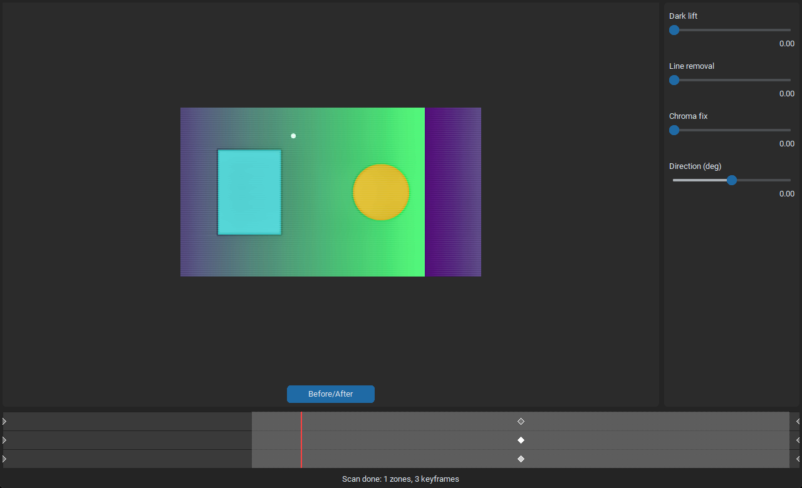
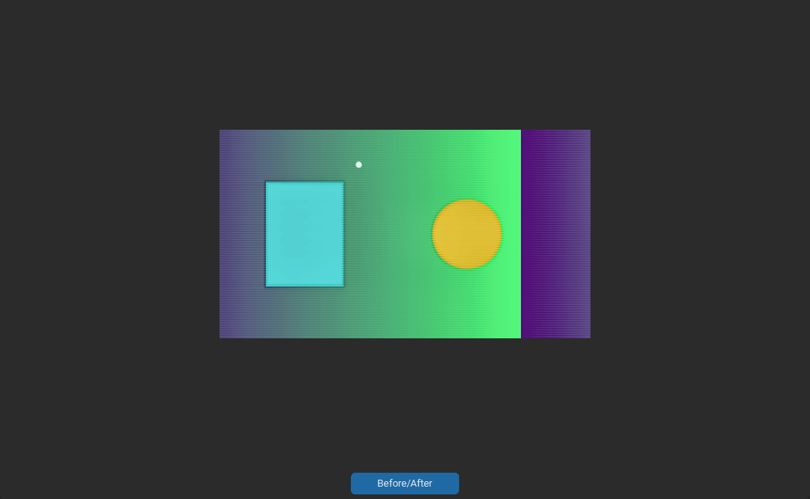

# dvrrestorer

Open-source timeline-based restorer for analog FPV drone DVR footage.
Four fixes over an OSD-aware pipeline — low-light boost, RF-stripe
removal, chroma-noise denoise, and per-keyframe strength blending —
driven by a desktop GUI or a headless CLI.

MIT License. Python 3.11+. Windows, macOS, Linux.



## Why

Analog FPV DVR files are rough: low light, rolling RF interference,
color noise, and an OSD overlay that must survive restoration intact.
Existing tools either ship as closed-source Windows trialware or process
the whole clip with one preset. `dvrrestorer` is free, cross-platform,
and lets you place keyframes on a timeline so each pass of the clip
gets exactly the strength it needs.

## Features

- **Timeline-keyframe GUI** — scrubbable preview, zone-highlighted
  timeline, three sliders per keyframe (dark lift, RF line removal,
  chroma fix) + global stripe direction.
- **Automatic scan** — per-frame luminance, chroma noise, and row-streak
  energy are measured once at open time; auto-keyframes are placed in
  the regions that need them.
- **OSD-aware pipeline** — a soft-alpha mask protects the on-screen
  display from every filter so battery readouts and timers stay sharp.
- **Headless CLI** — same pipeline, same profile files, no display
  required. Fits scripts and batch jobs.
- **Profile I/O** — save and load slider/keyframe sets as JSON.
- **Reproducible** — synthetic artifact generator and 56 tests.

## Install

```bash
git clone https://github.com/Froscht/dvrrestorer.git
cd dvrrestorer
python -m pip install -e .
```

For ONNX hardware acceleration pick one extra: `pip install -e .[cuda]`,
`[dml]` (Windows DirectML), or `[coreml]` (macOS).

## Quick start

### GUI

Launcher scripts in the repo root:

```bash
# Windows
start.bat

# Linux / macOS
./start.sh
```

Or run the module directly: `python -m dvrrestorer.gui.app`.

Open a clip via **File → Open...**, wait for the scan to finish, drag
keyframes to taste, then **File → Export...**.

### CLI

```bash
# Auto mode: scan, auto-place keyframes, export
dvrrestorer-cli INPUT.mp4 --auto -o OUT.mp4

# Reuse a saved profile
dvrrestorer-cli INPUT.mp4 --preset profiles/night.json -o OUT.mp4

# Side-by-side comparison video
dvrrestorer-cli INPUT.mp4 --auto --compare -o OUT.mp4
```

## Screenshots

| Full window | Preview pane | Timeline strip |
| --- | --- | --- |
|  |  |  |

The committed screenshots are generated from a synthetic test clip by
`scripts/make_screenshots.py` so they stay reproducible. Replace them
with real FPV captures once you have representative footage.

## Project layout

```
dvrrestorer/
  core/        pipeline, fixes, scan, zone detection, OSD mask
  gui/         customtkinter desktop app (app, preview, timeline, params)
  cli.py       headless entry point
scripts/       synthesize_dvr_artifacts.py, make_screenshots.py
tests/         pytest suite (headless + gui-marked)
docs/
  superpowers/specs/    design spec
  superpowers/plans/    phase-by-phase implementation plans
  screenshots/          README images
```

## Development

```bash
pip install -e .[dev]
pytest                      # headless suite
pytest -m gui               # GUI-marked tests (need a display)
python -m scripts.make_screenshots   # regenerate README images
```

## Roadmap

- **Phase 3** — dropout detection, ML denoiser backends (plugged into
  `onnxruntime`), HDZero digital-DVR mode.
- **Phase 4** — Zero-DCE low-light network as an alternative to the
  gamma + CLAHE baseline.

See `docs/superpowers/specs/` for the design spec and
`docs/superpowers/plans/` for per-phase plans.

## License

MIT — see `LICENSE`.
